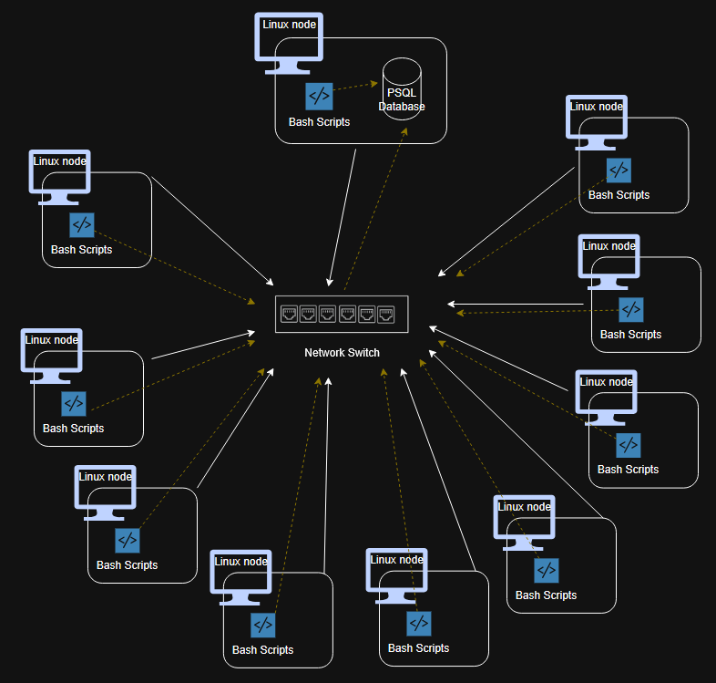

# Linux Cluster Monitoring Agent

## Introduction
The Linux Cluster Monitoring Agent is an MVP that helps the Jarvis Linux Cluster Administration (LCA) team record the hardware specifications 
for nodes and monitor node resource usage per minute. The Jarvis LCA team will use this MVP to generate reports from 
the data for a cluster of 10 nodes running Rocky Linux and manage future node resource planning. The MVP consists of 
bash scripts created using an IntelliJ IDEA IDE that initialize a PostgreSQL database within a Docker container and store
hardware specifications and usage data. The usage data is automated to be collected every minute using cron. The source code
is managed with Git on Github.
## Quick Start
1. Set up a PostgreSQL instance by creating and starting a Docker container. 
```bash
# Create the Docker container if not already
./scripts/psql_docker.sh create psql_user psql_password
# Start a PostgreSQL instance with Docker
./scripts/psql_docker.sh start
```
2. Initialize the database and the `host_info`and `host_usage` tables
```bash
# Will prompt to input psql_password 
psql -h psql_host -U psql_user -d db_name -f ./linux_sql/sql/ddl.sql
```
3. Insert node host hardware specification data into the `host_info` table.
```bash
./linux_sql/scripts/host_info.sh psql_host psql_port db_name psql_user psql_password
```
4. Insert a snapshot of host hardware usage data into the `host_usage` table.
```bash
./linux_sql/scripts/host_info.sh psql_host psql_port db_name psql_user psql_password
```
5. Create a crontab job to automate the app and collect and insert data for `host_usage` every minute.
```bash
crontab -e

* * * * * bash /absolute/path/to/linux_sql/scripts/host_usage.sh psql_host psql_port db_name psql_user psql_password > /tmp/host_usage.log
```
## Implementation

### Architecture
\
Linux nodes are connected on a network switch so that they can communicate with each other to send data. Each node has installed identical bash scripts. Each node will have `host_info.sh` to collect host hardware info (run once per node) and `host_usage.sh` to collect host usage data and provide an updated snapshot every minute using `cron`. 
One node has a PSQL database instance to store all the data and will send the results from their scripts directly to the
database. The other nodes send the data from their scripts through the network switch and the switch will then communicate with 
the node that has the database, allowing data from other nodes to be added to the database.
### Scripts

- `psql_docker.sh` is used to create, start, or stop a PSQL Docker container. A psql username and password must be passed if choosing to create a container.
- `ddl.sql` is used to create the `host_agent` database as well as the `host_info` and `host_usage` tables needed for the agent if they don't exist already. The script specifies the  variables and constraints for each table. Values for psql host, database name, and psql username should be passed when running the script. The script assumes that the Docker container is running.
- `host_info.sh` should run once for each node to collect host hardware specification data and insert the data into the `host_info` table. Values for a psql host, port, database name, psql username, and password must be passed when running the script. The script assumes that the `host_info` table is already initialized and that the Docker container is running.
- `host_usage.sh` is used to collect host hardware usage data at the time that the script is called and then inserts the data into the `host_usage` table. Values for a psql host, port, database name, psql username, and password must be passed when running the script. The script assumes that the `host_usage` table is already initialized and that the Docker container is running.
- The commands below run `crontab` on the bash CLI to automate calling `host_usage.sh` every minute to capture and save multiple snapshots of hardware usage data into the `host_usage` table.  
```bash
crontab -e

* * * * * bash /absolute/path/to/linux_sql/scripts/host_usage.sh psql_host psql_port db_name psql_user psql_password > /tmp/host_usage.log
```

### Database Modeling
The database consists of two tables, `host_info` and `host_usage`.

The `host_info` table holds data on the host's hardware specifications and consists of:  

| Variable | Description |
|----------|-------------|
| id       | Unique id number auto-incremented by PostgreSQL corresponding to each node |
| hostname|   The full unique name for the host         |
|cpu_number     |  The number of cores the CPU has|
|cpu_architecture| The architecture of the CPU|
|cpu_model        |The name of the CPU model|
|cpu_mhz          |The clock speed in MHz of the CPU|
|l2_cache         |The size of the L2 cache in Kb|
|timestamp      |The current time in UTC time zone in Y-M-D H:M:S 24 hour time format |
|total_mem        | Total amount of memory in the node in Kb|

The `host_usage` table stores data on the host's hardware resource usage and consists of:

| Variable | Description |
|----------|-------------|
| host_id      | Unique id number from the `host_info` table |
| memory_free|   The amount of free memory in Mb for the node        |
|cpu_idle| The percentage of time that the CPU is idle|
|cpu_kernel       |The percentage of time that the CPU is running kernel code|
|disk_io           |The number of disks under I/O processes|
|disk_available        |The amount of disk available in Mb for the root directory|
|timestamp      |The current time in UTC time zone in Y-M-D H:M:S 24 hour time format |


## Test
The bash scripts DDL were tested by running a new PostgreSQL container using `psql_docker.sh` and executing the scripts to create an MVP.
`psql -h localhost -U “postgres” -d “host_agent” -f ./linux_sql/sql/ddl.sql`
ran once and then again to test if the code handles repeat executions without error. To inspect the tables, `psql -h localhost -U postgres -W` and then 
`\c host_agent` ran to connect to the database. 
Then, `SELECT * FROM host_info;` and `SELECT * FROM host_usage;` ran to view the empty tables. 
Bash scripts for inserting data were tested by adding `bash -x` when running the 
code (e.g. `bash -x ./myscript.sh`) to debug issues. The tables were then inspected as mentioned above to see if data  were inputted and displayed correctly into the tables.
After running the crontab commands, `crontab -l` was used to view the jobs and then from the psql instance,
`SELECT * FROM host_usage;` ran to view if there was new data every minute. The tables were found to have the
appropriate data and the `host_usage` table received update snapshots correctly when testing.
## Deployment

The app was deployed on Rocky Linux 9. The app consisted of bash scripts created using an IntelliJ IDEA IDE and bash command line code.
The scripts initialized a PostgreSQL database within a Docker container and used the psql instance to store tables.
The scripts were scheduled using crontab.The source code
was managed with Git on Github.

## Improvements
- Add queries on `queries.sql` to analyze resource usage. E.g. average memory usage per hour.
- Add a way to update hardware specifications, removing the assumption that a node doesn't change their hardware.
- Add scripts to help the LCA team generate graphs and visualizations from the data to use for their reports.  
